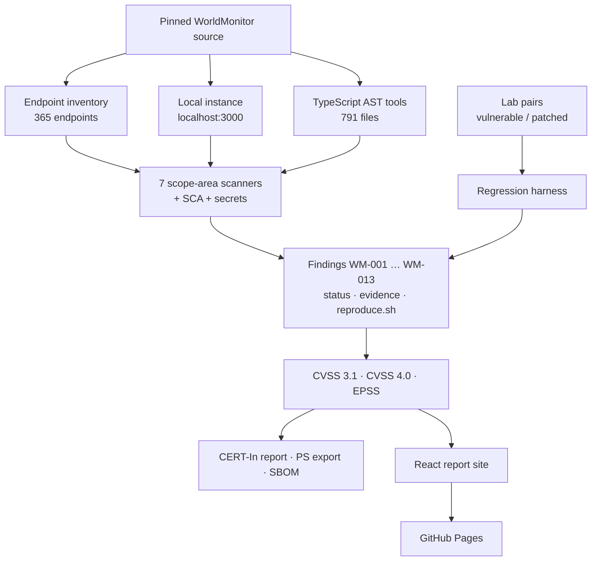
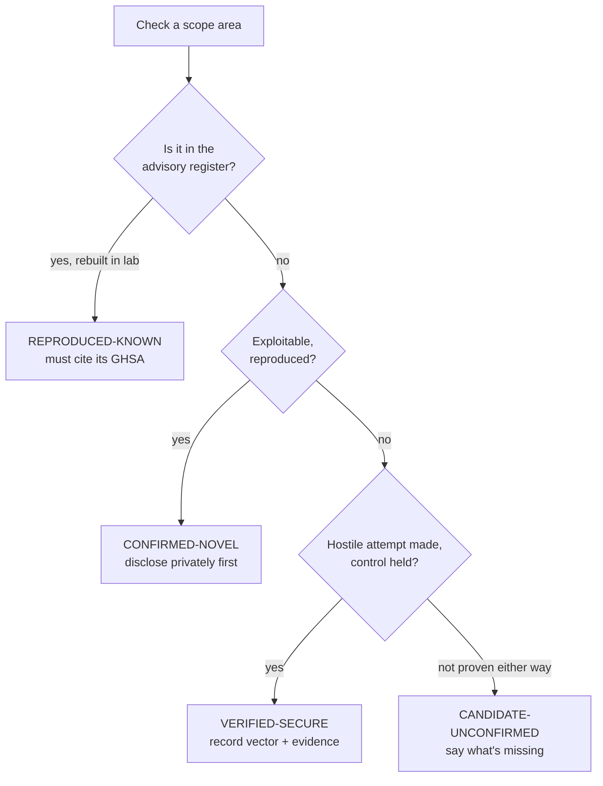

<div align="center">

# SEAM

**A security assessment you can re-run, check and argue with**

*Advisory-aware assessment of the WorldMonitor application, scored in code and rebuilt by CI on every push*

**Smart India Hackathon 2026 · Problem Statement 26163 · Organisation: NTRO · Category: Software**

[Live report](https://arushjain-697.github.io/SIH-2026/) · [CERT-In report](report/report.md) · [Coverage matrix](docs/coverage-matrix.md) · [Rules of engagement](docs/ROE.md)

<!-- Screenshot placeholder: add docs/images/report-console.png (the report site's findings console) and uncomment

-->

</div>

---

## Overview

Security reviews of a large, fast-moving codebase usually end up as slides: a list of claims nobody can check. NTRO
asked for an assessment of WorldMonitor (`github.com/koala73/worldmonitor`, AGPL-3.0), a large open-source
TypeScript app. We wanted one a reviewer could re-run, inspect and challenge. It should keep "we reproduced this"
apart from "we checked this and it held" and from "this might be a problem", and it should report controls that held
as clearly as bugs.

SEAM fetches the real source at a pinned commit, runs the real app on `localhost`, and scans all seven scope areas
in the problem statement. Every verdict is scored in code (CVSS 3.1, CVSS 4.0, EPSS). It reproduces published
advisory classes as vulnerable/patched lab pairs, and it publishes the result as a live report. Nothing in the report
is typed by hand. A GitHub Actions workflow regenerates it from the findings on every push.

For each run, SEAM:

1. Shallow-clones WorldMonitor at a pinned commit and starts it on `localhost:3000`.
2. Builds an inventory of every endpoint (365 found, 236 of them gateway routes).
3. Runs seven scanners, one per scope area, plus dependency (SCA) and secrets scanners.
4. Writes each result as a finding with an explicit status, evidence and a `reproduce.sh`.
5. Scores it with its own CVSS 3.1 and 4.0 calculators and looks up EPSS from FIRST.
6. Runs the regression harness: each reproduced advisory must still leak on the vulnerable variant and stop on the patched one.
7. Regenerates the CERT-In report, the PS-format export, the SBOM and the React report site, and deploys to GitHub Pages.

WorldMonitor's maintainer has already published 11 security advisories (plus 1 draft). SEAM uses them as prior art:
it reproduces two to prove the method works, and never claims them as discoveries.

## Features

| Capability | Description |
|---|---|
| Seven scope-area scanners | Auth and sessions, access control, input validation, API security, client-side, secure communication, data storage |
| TypeScript AST pass | TypeScript Compiler API over 791 real source files, so checks run on the real syntax tree instead of a regex |
| Re-derived guardrails | Independently re-checks the target's own CI rules: rate-limit coverage on 236 routes, CORS in 24 files, 262 type-cast sites |
| Explicit status on every finding | `REPRODUCED-KNOWN`, `CONFIRMED-NOVEL`, `CANDIDATE-UNCONFIRMED` or `VERIFIED-SECURE` |
| Scoring in code | CVSS 3.1 and 4.0 calculators in the engine; the 4.0 one matches FIRST's reference on 2000 of 2000 random vectors |
| EPSS | Live lookup against FIRST's public API, with "not applicable" when a finding has no CVE |
| Regression harness | Vulnerable/patched lab pairs, auto-discovered from manifests, re-run on every build |
| Remediation patches | Two real diffs, verified with `git apply --check` or `git diff --no-index` |
| Supply chain | `npm audit` over the real lockfile, a lockfile ancestry tracer, and a CycloneDX 1.5 SBOM (1,666 components) |
| Generated outputs | CERT-In-format report, a PS-schema export in the problem statement's field order, the coverage matrix check |
| Safety in code | Every network request goes through one probe that throws on any host outside `localhost`, `127.0.0.1` and `::1` |

> **Decision:** the probe refuses non-local hosts in code instead of relying on everyone remembering the rules. The
> test for it fires at the real production hostname and checks that the request is refused.

---

## Problem statement (SIH 2026 · PS 26163)

| Requirement | What SEAM delivers |
|---|---|
| Assess the WorldMonitor application | Real source at a pinned commit, real app running locally, 365 endpoints inventoried |
| Cover the listed security areas | 7 of 7 scope areas have direct evidence; none marked "not tested" |
| Report each vulnerability with title, description, component, CVSS, steps, PoC, impact, remediation | Generated PS-schema export, in exactly that field order, for every finding |
| Proof of concept | `reproduce.sh` for every finding; benign markers only |
| Remediation | Specific changes per finding, two as verified diffs |

---

## What makes it different

1. **Every claim can be re-run.** Each finding has its evidence and a `reproduce.sh`. If the script doesn't reproduce it, it isn't confirmed.
2. **It reports what held, not just what broke.** 10 of the 13 findings are controls that held under a deliberate attempt to break them. An all-critical report on a hardened app would not be believable.
3. **It says when it found nothing new.** No novel vulnerability came out of this pass, and the report says so instead of inflating a candidate into a finding.
4. **The method is checked against known bugs.** Two of the maintainer's own published advisories are rebuilt as vulnerable/patched pairs. The harness has to catch the vulnerable one and pass the patched one on every build.

> **Decision:** the dependency scan found 4 advisories in the transitive tree of the app's live auth SDK. That shows
> the package is imported, not that the vulnerable functions ever run. It's reported as `CANDIDATE-UNCONFIRMED`
> rather than rounded up to a finding or down to nothing.

---

## Architecture

### The pipeline



Every dynamic request goes through `engine/probe/safe-http.mjs`, which refuses any host outside the local lab.

### How a finding gets its status



A schema test enforces these rules. A `REPRODUCED-KNOWN` finding without a GHSA reference fails the build, and so
does a `CONFIRMED-NOVEL` finding that's already in the register.

---

## Tech Stack

| Area | Technology |
|---|---|
| Engine and scanners | Node.js 18+ (ESM), zero external dependencies |
| AST analysis | TypeScript Compiler API, in its own sub-package (`engine/scanners/ast-tools`) |
| Scoring | In-repo CVSS 3.1 and 4.0 calculators, FIRST EPSS API client, SSVC-inspired priority engine |
| Supply chain | `npm audit` on the lockfile, lockfile ancestry tracer, CycloneDX 1.5 SBOM |
| Report site | React 18, TypeScript, Vite, `motion`, `lucide-react` |
| CI and hosting | GitHub Actions, GitHub Pages |
| Target under test | WorldMonitor built from source, Vite dev server on `localhost:3000` |

---

## Deep Dive: The Layers

### Layer 1: the advisory register and "seams"

`register/advisories.json` lists the maintainer's 12 advisories (11 published, 1 draft). Each is tagged with the
*seam* behind it, meaning the kind of mistake that produced it rather than the specific bug: `toctou-refund-race`,
`isomorphic-sibling-path`, `fail-open-async`, `linter-satisfied-semantically-dead` and so on. Each one is also tied
to an outside authority the target didn't write, such as Convex's access-control guidance, Cloudflare's header-trust
docs or the NSA's MCP security paper. The scanners then look for the same seam elsewhere in the code.

### Layer 2: the scanners

| Scope area | What was checked | Result |
|---|---|---|
| Auth and sessions | JWT algorithm pinned to RS256, OAuth state consumed with atomic `GETDEL`, cookie flags on all 5 constructions | Held (WM-008) |
| Access control | BOLA reproduced from `GHSA-r649`; AST pass over 38 ServiceClient classes found 9 premium call sites | Reproduced (WM-001); all 9 gated (WM-009) |
| Input validation | 262 of 262 `as any` / `as unknown` casts reviewed; central gateway validation wiring | 0 unsafe (WM-005); held (WM-010) |
| API security | Denial-of-Wallet reproduced from `GHSA-hcq5`; rate limits on 236 routes (18 non-GET); idempotency keys | Reproduced (WM-002); 0 gaps (WM-003); held (WM-011) |
| Client-side | All 27 `localStorage` keys dumped from the running app and scanned for credential shapes | 0 hits (WM-007) |
| Secure communication | CORS in 24 files; headers captured live and checked against `vercel.json` | 0 unsafe (WM-004); hardened in production (WM-006) |
| Supply chain and secrets | 1,795 dependencies; 21 `VITE_` env vars checked with a broader pattern than the target's own | 1 candidate (WM-012); 0 real hits (WM-013) |

> **Decision:** the first auth-scanner pass reported 3 hits that were only mentions in comments. They were caught,
> removed, and written up in the finding instead of quietly fixed.

### Layer 3: scoring

CVSS 3.1 and 4.0 are calculated in the engine, not copied from a website. The 4.0 calculator was checked against the
unmodified FIRST reference implementation on 2000 random vectors with 0 mismatches before it was used on any finding.
Every CVSS 3.1 vector embedded in an `npm audit` result was re-scored with the same calculator, and 6 of 6 matched.

A held control has nothing to score, so a `VERIFIED-SECURE` finding shows `N/A` for severity instead of a made-up
number. EPSS only applies to CVEs, so a GHSA-only finding gets an explicit "not applicable".

### Layer 4: the regression harness

Each reproduced advisory is a pair of small services, one vulnerable and one patched, built from the advisory's
description. The harness discovers every `lab/repro-services/*/manifest.mjs` on its own, so a new pair needs no
harness change.

| Advisory | Vulnerable variant | Patched variant |
|---|---|---|
| `GHSA-r649` (BOLA) | leaks cross-tenant rows | doesn't |
| `GHSA-hcq5` (Denial-of-Wallet) | 10 attack calls, quota used = 0 | quota capped at 3/3 |

> **Decision:** the WM-002 patch is a diff between our own vulnerable and patched lab files, and it's labelled that
> way. The real target is already fixed and we don't hold a vulnerable copy of their code, so presenting it as a patch
> against WorldMonitor would be misleading.

### Layer 5: the report

`npm run assess` runs the static scanners and then regenerates the proof spine, the CERT-In report, the PS export,
the coverage matrix check and the React site. In CI, `.github/workflows/assess.yml` also starts the real target
inside the runner and publishes the site to GitHub Pages. Because of the probe's allowlist, CI never touches the live
`worldmonitor.app` either.

---

## Results

| Metric | Value |
|---|---|
| Scope areas with direct evidence | **7 of 7** |
| Findings | **13**: 2 reproduced-known, 10 verified-secure, 1 candidate-unconfirmed, 0 confirmed-novel |
| Endpoints inventoried | **365** (236 gateway routes) |
| Source files parsed by the AST pass | **791** |
| Prior advisories mapped | **12** (11 published, 1 draft) |
| Regression suite | **2 of 2** pass |
| CVSS 4.0 calculator vs FIRST reference | **2000 of 2000** match |
| Dependencies scanned / SBOM components | **1,795 / 1,666** |
| Verified remediation patches | **2** |
| `npm test` | **14 steps, 0 failures** |

No novel finding was produced, and the report says so. The two areas investigated most deeply both held under
independent checking.

---

## Project Structure

```
engine/
  probe/safe-http.mjs     the only way any scanner touches the network
  inventory/              endpoint inventory
  scanners/               one per scope area, plus SCA, SBOM and secrets; ast-tools/ for TypeScript
  core/                   CVSS 3.1/4.0, EPSS, priority engine
  report/                 PS export and report-site data
framework/                seam-linter tools, regression harness, finding schema, report generators
findings/                 WM-001 … WM-013: finding.md, evidence/, reproduce.sh
lab/                      target fetch script, mock upstream, vulnerable/patched lab pairs
register/advisories.json  prior-art register
report/                   generated CERT-In report and PS export
report-app/               React report site
docs/                     rules of engagement, ground truth, coverage matrix, proof spine, recovery guide
tests/                    unit, safety, schema and landmine tests
.github/workflows/        full pipeline and Pages deploy
```

---

## Installation

Needs Node.js 18+ (CI uses 24). The engine has no dependencies to install.

```bash
git clone https://github.com/ArushJain-697/SIH-2026.git && cd SIH-2026
npm test                              # 14 steps: safety, calculators, schema, harness
npm --prefix report-app install && npm start     # report site locally
```

Run the full assessment against the real target:

```bash
npm run fetch-target        # shallow-clone WorldMonitor at the pinned commit (read-only)
npm run instance:install    # install the target's dependencies
npm run instance:up         # start it on localhost:3000 (separate terminal)
npm run assess              # scanners, proof spine, report, PS export, coverage check, report site
```

Single pieces:

```bash
npm run scan:all-static             # all static scanners
npm run dynamic-scan                # header and storage checks against the local instance
npm run regress                     # regression harness
bash findings/WM-002/reproduce.sh   # reproduce one finding
```

The target clone is about 2 GB with dependencies and is gitignored under `.cache/`. If something fails, see
[`docs/RECOVERY.md`](docs/RECOVERY.md).

---

## Limitations and responsible use

- This is a time-boxed, authorised slice, not a full production penetration test.
- All active testing runs against a local instance built from source. `worldmonitor.app` gets passive, unauthenticated header observation only, and no paid third-party API is ever called.
- The two reproductions are minimal lab services built from the advisories' descriptions, labelled as such.
- WM-012 is a candidate: reachability of the vulnerable functions wasn't confirmed.
- The local instance has no Redis, so live rate-limit *counting* can't be confirmed locally. Rate-limit *coverage* is verified statically instead.
- Server-side storage (Upstash, R2, Convex) wasn't tested dynamically, since that needs authenticated access this assessment deliberately didn't get. The desktop (Tauri) app is out of scope.
- Published advisories are cited as prior art, never as discoveries. A genuinely new finding would go to the maintainer privately through `SECURITY.md` first.

---

## Glossary

| Term | Meaning |
|---|---|
| GHSA | GitHub Security Advisory ID |
| Seam | The kind of mistake behind an advisory (e.g. a check-then-refund race), used to look for the same pattern elsewhere |
| BOLA | Broken object-level authorization: reading another user's data by changing an ID |
| Denial-of-Wallet | Making a service run up paid API calls instead of taking it down |
| CVSS | Common Vulnerability Scoring System, versions 3.1 and 4.0 |
| EPSS | Exploit Prediction Scoring System: probability a CVE gets exploited in the next 30 days |
| SCA | Software composition analysis: checking dependencies for known vulnerabilities |
| SBOM | Software bill of materials; here in CycloneDX 1.5 format |
| Verified-secure | A deliberate attempt to break a control was made and the control held |
| Lab pair | A vulnerable and a patched version of the same small service |

---

## Documentation

- [`report/report.md`](report/report.md): the CERT-In-format report
- [`report/ps-schema-export.md`](report/ps-schema-export.md): every finding in the problem statement's field order
- [`docs/coverage-matrix.md`](docs/coverage-matrix.md): the 7 scope areas by verdict
- [`docs/proof-spine.md`](docs/proof-spine.md): each risk class tied to an outside authority and a real advisory
- [`docs/ROE.md`](docs/ROE.md): rules of engagement
- [`docs/ground-truth.md`](docs/ground-truth.md): verified facts about the target
- [`docs/progress.md`](docs/progress.md): build log and design decisions
- [`docs/RECOVERY.md`](docs/RECOVERY.md): troubleshooting

---

## Team

<!-- Team details to be added: names and roles -->
Team details to be added.

